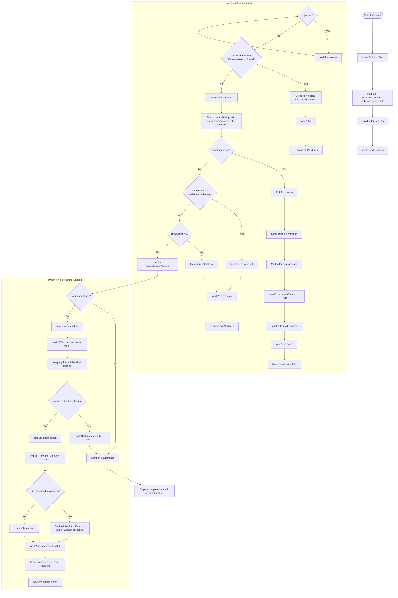

# Chase Offer Adder

> **Automate Chase Offers with ease!** Stop clicking endlessly and save time by automatically adding Chase Offers across all your credit cards.

[](https://opensource.org/licenses/MIT)
[]()

## 🚀 Quick Start

1. **Install** the extension (see [Installation](#installation) below)
2. **Navigate** to your Chase Offers page
3. **Click** the extension icon and hit "Add offers"
4. **Sit back** and watch it work automatically!

## 📋 Table of Contents

- [Overview](#overview)
- [Logic Flow Chart](#logic-flow-chart)
- [Features](#features)
- [Installation](#installation)
- [How to Use](#how-to-use)
- [Screenshots](#screenshots)
- [Troubleshooting](#troubleshooting)
- [FAQ](#faq)
- [Changelog](#-changelog)
- [Disclaimer](#disclaimer)
- [For Developers](#for-developers)

## 📖 Overview

This Chrome extension automates the tedious process of adding Chase Offers to your credit cards. Instead of manually clicking through each offer and account, the extension:

- **Automatically detects** and clicks "Add to Card" buttons across all page sections
- **Switches between accounts** seamlessly
- **Provides real-time feedback** on progress
- **Pause/resume functionality** for complete control
- **Enhanced retry mechanism** with smart loading detection for maximum reliability
- **Handles errors gracefully** with clear status messages

### How It Works

1. 🔍 **Scans** both carousel (featured) and grid (all offers) sections for available "Add to Card" buttons
2. 🖱️ **Clicks** each button automatically with retry logic
3. 🔄 **Switches between tabs** if multiple page tabs exist
4. 🔄 **Switches accounts** when all offers/tabs are complete
5. 📊 **Updates status** in real-time
6. ⏸️ **Pause/resume** controls for full user control

## 📊 Logic Flow Chart

Here is the logic flow chart for the automation script:



## ✨ Features

- **🎯 Smart Button Detection**: Automatically finds and clicks "Add to Card" buttons in all page sections
- **📑 Multi-Section Support**: Processes both carousel (featured) and grid (all offers) sections automatically
- **📑 Multi-Tab Support**: Detects and cycles through page tabs if they exist
- **🔄 Multi-Account Support**: Processes offers across all your credit card accounts
- **✅ Smart Filtering**: Skips offers already added (with checkmark icons)
- **⏸️ Pause/Resume Controls**: Stop and continue the process at any time
- **🔁 Enhanced Retry Logic**: 5-retry mechanism with smart loading detection for maximum reliability
- **📊 Real-time Status**: Live updates on progress, tab switching, and account switching
- **🛡️ Error Handling**: Graceful handling of various scenarios
- **🧭 Smart Navigation**: Efficient browser navigation between offers
- **🎚️ Auto-Scroll**: Automatically scrolls to buttons that are off-screen

## 📋 Prerequisites

- ✅ **Google Chrome** browser (version 88 or higher)
- ✅ **Chase Online Banking** account with active credit cards
- ✅ **Available Chase Offers** on your accounts

## 🔧 Installation

1. **📥 Download the Extension**

    ```bash
    git clone https://github.com/yourusername/chase-offer-adder.git
    ```

2. **🌐 Open Chrome Extensions**
    - Navigate to `chrome://extensions/`
    - Enable "Developer mode" (top-right toggle)

3. **📁 Load the Extension**
    - Click "Load unpacked"
    - Select the `chase-offer-adder` folder
    - The extension icon will appear in your toolbar


## 🎯 How to Use

1. **Navigate to Chase Offers**
    - Log into your Chase Online Banking
    - Go to your available offers page

2. **Start the Automation**
    - Click the extension icon in your toolbar
    - Click "Add offers" in the popup
    - The automation begins immediately

3. **Monitor Progress**
    - Watch real-time status updates
    - Use Pause/Resume as needed
    - Extension handles account switching automatically

### Controls

- **Add offers**: Start the automation
- **Pause**: Temporarily stop the process
- **Resume**: Continue from where you left off

## 🔧 Troubleshooting

**Extension not working:**

- Ensure you're on a Chase Offers page
- Refresh the page and try again
- Check that the extension is enabled

**No buttons found:**

- Confirm you're on the correct offers page
- Verify you have available offers
- Make sure you're logged into Chase

**Process stops:**

- Use Pause/Resume to restart
- Check your internet connection
- Refresh and restart if needed

**Tips for best results:**

- Keep the popup open while running
- Don't interact with the page during automation
- Use a stable internet connection

## ❓ FAQ

**Q: Is this safe to use?**
A: Yes, the extension only interacts with Chase's website and doesn't collect personal information.

**Q: Does this work with multiple accounts?**
A: Yes, it automatically detects and processes all your credit card accounts.

**Q: What if Chase updates their website?**
A: The extension may need updates if Chase changes their structure. Check for updates regularly.

**Q: Does this work on mobile?**
A: No, this is a Chrome desktop extension only.

**Q: What if it gets stuck?**
A: Use the Pause button, refresh the page, and restart.

## 📸 Screenshots

### Extension Interface


### Chase Offers Page Example


## 📝 Changelog

Functional changes only — full commit-level detail lives in `git log`. Versions use [CalVer](https://calver.org) (`YYYY.M.D`, with a trailing `.N` for same-day releases) instead of semver, since compatibility here is really "does this still work against Chase's current site," not an API contract.

### 2026.10.12

- 🐛 **Fixed account switching again**: Chase replaced the account combobox/dropdown with a trigger button (`data-testid="account-selector-trigger"`) that opens a bottom sheet (`#accountSelectorSheet`). The old selectors matched nothing, so runs ended after the first account. Now targets the new sheet and its `.accountSelectorListItem` rows, keeps the pre-October selectors as fallbacks, and polls for the sheet to render instead of assuming a fixed 500ms

### 2026.8.16

- 🔧 Switched version numbers from semver (`1.x.x`) to CalVer (`YYYY.M.D`) — a version now tells you the last date it was verified against Chase's site, which matters more here than semantic compatibility
- 🔒 Added [gitleaks](https://github.com/gitleaks/gitleaks) secret scanning: on staged changes in the pre-commit hook (when installed locally) and on full history in CI, where it now gates release packaging
- 🔧 CI now fails if `manifest.json` and `package.json` versions drift apart or the version isn't valid for the Chrome Web Store

### 2026.8.15

- 🐛 **Fixed account switching**: Chase changed the account dropdown's DOM so the extension's selector no longer matched anything, silently ending the run instead of moving to the next account. Now targets the stable `data-testid` attribute instead of the (now random, per-session) element `id`.
- 🐛 Fixed the current-account-name detector, which had been silently falling back to "Account 1" for every account because of the same stale selector plus a hashed CSS class Chase no longer uses.
- ✨ **Offer names in the completion summary**: the summary now lists which offers were added per account, not just a count.
- ✨ **Progress survives closing the popup**: status, progress bar, and pause state are now persisted and restored if you close the popup mid-run and reopen it — previously the UI reset to blank even though automation kept running in the background.

### 2026-06-20 — 2026-06-24 — Reliability hardening

- 🐛 Switched the account selector to Chase's new combobox pattern
- 🐛 Added `safeClick` (falls back to a dispatched `MouseEvent` when `.click()` isn't available), redirect recovery for the "switch account → bounced to dashboard overview" case, and better detail-page navigation handling
- 🧪 Tried a "staggered parallel" offer-clicking mode; reverted it in the same week — clicking an offer navigates the single-page app to a detail route, so parallel clicks in one tab raced each other instead of adding offers reliably
- ♻️ Removed dead code and duplicate button styling

### 2025.11.23

- ✨ New popup UI: progress bar, live stats, and a completion summary with a Chrome notification when a run finishes
- ✨ Dog-themed, Material Design–inspired visuals with status-based imagery
- ✨ Status messages while switching accounts (2025-11-27)
- ✨ Enhanced retry mechanism (5 retries with smart loading detection, up from 3 retries/1s)
- ✨ Automatic scrolling for off-screen buttons
- ✨ Section-aware processing (carousel + grid offer sections)
- 🔧 Disclaimer added to the popup footer

### 2025-11-09 — Chase November 2025 UI overhaul

- 🐛 Adapted all selectors after Chase replaced `<mds-icon>` elements with plain `<svg>` elements for add/checkmark icons — the single biggest source of breakage historically

### 2025-10-18 — 2025-10-26 — Detection & multi-tab support

- ✨ Multi-tab support: detects and cycles through page tabs before switching accounts
- ✨ Featured-offers (carousel) handling alongside the main grid
- ♻️ Simplified offer identification and button-counting logic

### 2025-05-10 — Account switching & Chase format update

- ✨ First account-switching implementation, with a pause button
- 🐛 Updated the icon detector/clicker for a Chase.com layout change

### 2025-04-14 — Initial prototype

- 🎉 First working version: popup-triggered script injection, add-button detection, and status messaging

## ⚖️ Disclaimer

- **Personal coding practice project**
- Not affiliated with JPMorgan Chase & Co.
- Use at your own risk
- This extension is provided "as-is" without warranty
- Chase website changes may break functionality
- Your responsibility to comply with Chase's terms of service

## 👨‍💻 For Developers

Interested in the technical details, development setup, or contributing? Check out our comprehensive [**Technical Documentation**](TECHNICAL.md) for:

- 🏗️ Architecture and code structure
- 🧪 Development commands and testing
- ⚙️ Chrome extension implementation details
- 🔧 Advanced configuration and debugging
- 🤝 Contributing guidelines
- 📝 Recent updates and version history

## 📄 License

MIT License - see [LICENSE](LICENSE) file for details.

---

**Version:** 2026.10.12
**Last Updated:** 2026-10-12

See [Changelog](#-changelog) above for functional history, or [TECHNICAL.md](TECHNICAL.md) for detailed technical changes.
