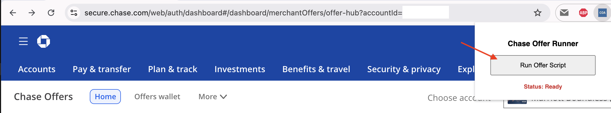
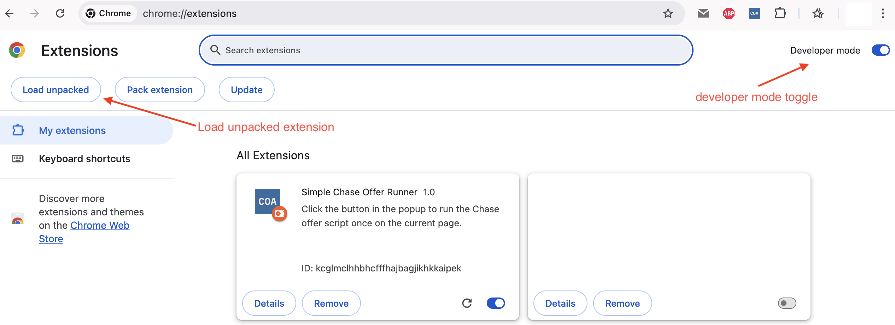
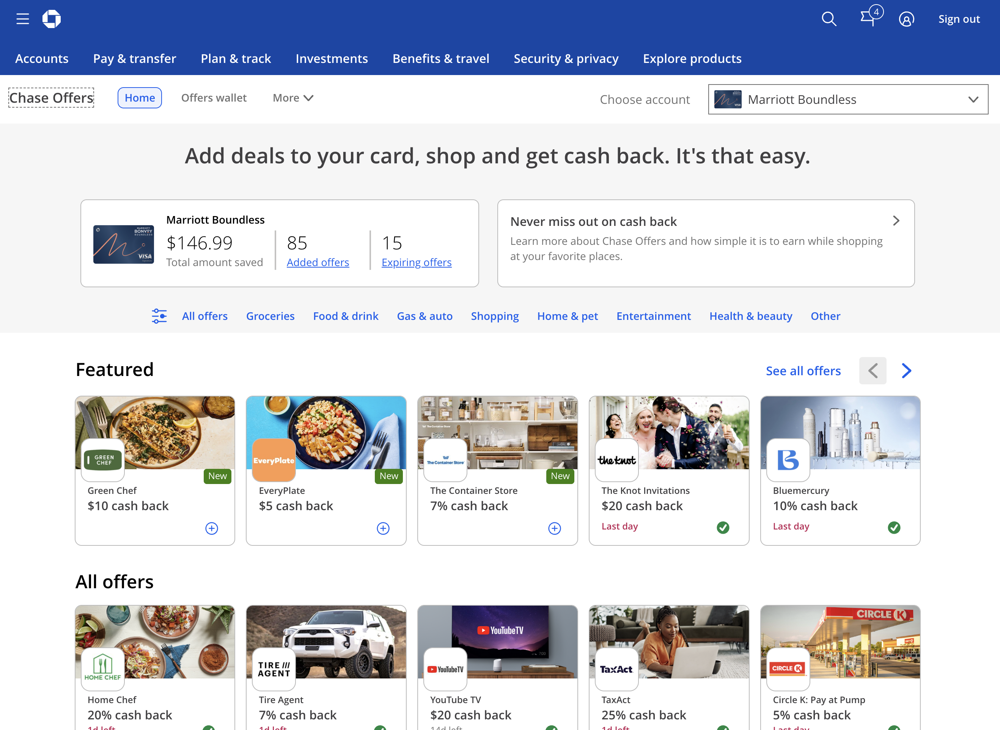
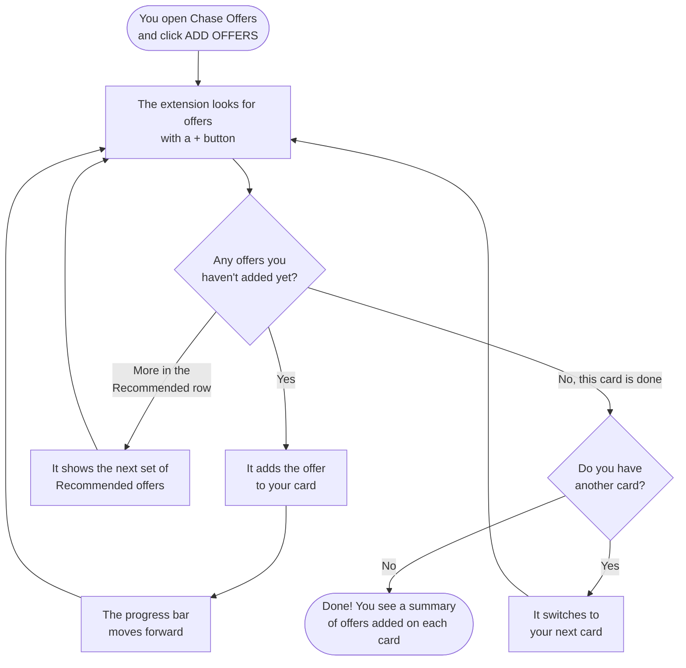

<a id="readme-top"></a>

<!-- PROJECT SHIELDS -->
[![Stars][stars-shield]][stars-url]
[![Issues][issues-shield]][issues-url]
[![Last commit][last-commit-shield]][last-commit-url]
[![MIT License][license-shield]][license-url]

<!-- PROJECT LOGO -->
<br />
<div align="center">
  <a href="https://github.com/kamingfung/chase_offer_auto_enroll">
    
  </a>

  <h3 align="center">Chase Offer Adder</h3>

  <p align="center">
    A Chrome extension that adds every Chase Offer to every one of your credit cards in one click.
    <br />
    <a href="TECHNICAL.md"><strong>Explore the technical docs »</strong></a>
    <br />
    <br />
    <a href="#usage">How it works</a>
    &middot;
    <a href="https://github.com/kamingfung/chase_offer_auto_enroll/issues/new?labels=bug">Report Bug</a>
    &middot;
    <a href="https://github.com/kamingfung/chase_offer_auto_enroll/issues/new?labels=enhancement">Request Feature</a>
  </p>
</div>

<!-- TABLE OF CONTENTS -->
<details>
  <summary>Table of Contents</summary>
  <ol>
    <li>
      <a href="#about-the-project">About The Project</a>
      <ul>
        <li><a href="#built-with">Built With</a></li>
      </ul>
    </li>
    <li>
      <a href="#getting-started">Getting Started</a>
      <ul>
        <li><a href="#prerequisites">Prerequisites</a></li>
        <li><a href="#installation">Installation</a></li>
      </ul>
    </li>
    <li><a href="#usage">Usage</a></li>
    <li><a href="#troubleshooting">Troubleshooting</a></li>
    <li><a href="#faq">FAQ</a></li>
    <li><a href="#contributing">Contributing</a></li>
    <li><a href="#license">License</a></li>
    <li><a href="#disclaimer">Disclaimer</a></li>
  </ol>
</details>

<!-- ABOUT THE PROJECT -->
## About The Project



Chase gives you dozens of cash-back offers per card, and each one needs its own "Add to Card" click. With several cards, that is hundreds of clicks. This extension does the clicking for you:

- **Finds every offer**: it scans the Recommended offers row and the full offer list, and pages through the Recommended row to reach hidden offers.
- **Skips what you already added**: offers with a checkmark are left alone, so running it again is safe.
- **Switches cards for you**: when one card is done, it moves to the next.
- **Retries when the page is slow**: up to 5 retries, with loading detection.
- **Shows progress live**: a progress bar and a per-card summary at the end.
- **Pause and resume**: stop at any time and pick up where you left off.
- **Auto-scrolls**: off-screen buttons are scrolled into view before clicking.

<p align="right">(<a href="#readme-top">back to top</a>)</p>

### Built With

- Chrome Extension Manifest V3
- Plain JavaScript, HTML and CSS (no runtime dependencies)
- Jest for tests

<p align="right">(<a href="#readme-top">back to top</a>)</p>

<!-- GETTING STARTED -->
## Getting Started

### Prerequisites

- Google Chrome, version 88 or higher
- A Chase Online Banking account with active credit cards
- Chase Offers available on those cards

### Installation

1. Clone the repo.

   ```bash
   git clone https://github.com/kamingfung/chase_offer_auto_enroll.git
   ```

2. Open `chrome://extensions/` in Chrome.
3. Turn on **Developer mode** (top-right toggle).
4. Click **Load unpacked**.
5. Select the cloned `chase_offer_auto_enroll` folder. The extension icon appears in your toolbar.



<p align="right">(<a href="#readme-top">back to top</a>)</p>

<!-- USAGE -->
## Usage

1. Log in to Chase Online Banking.
2. Open your offers page.
3. Click the extension icon in your toolbar.
4. Click **Add offers**.
5. Watch the progress bar. Use **Pause** and **Resume** as needed.



### What happens when you click "Add offers"



While it runs:

- **Pause anytime** with the Pause button. Resume picks up where it left off.
- **Closing the popup is fine.** The extension keeps working, and reopening the popup shows your progress.
- **Short pauses are normal.** If the page is still loading, the extension waits and tries again.
- **Offers you already added are skipped**, so running it again is safe.

<p align="right">(<a href="#readme-top">back to top</a>)</p>

<!-- TROUBLESHOOTING -->
## Troubleshooting

| Symptom | Try this |
|---|---|
| Extension does nothing | Check you are on a Chase Offers page and the extension is enabled. Refresh the page and try again. |
| "No buttons found" | Check you are logged in, on the offers page, and have offers left to add. |
| Process stops | Click Pause, then Resume. If it is still stuck, refresh the page and start again. |

For best results, do not click on the page while the extension runs, and use a stable internet connection.

<p align="right">(<a href="#readme-top">back to top</a>)</p>

<!-- FAQ -->
## FAQ

**Is this safe to use?**
Yes. The extension refuses to run on any site other than Chase and makes no network requests of its own, so nothing is sent anywhere. The only thing it saves is the last run's progress and summary, kept locally in your Chrome profile.

**Does it work with multiple cards?**
Yes. It detects and processes all your credit card accounts.

**What if Chase updates their website?**
The extension may need an update. Check this repo for new versions.

**Does it work on mobile?**
No. It is a Chrome desktop extension only.

<p align="right">(<a href="#readme-top">back to top</a>)</p>

<!-- CONTRIBUTING -->
## Contributing

Contributions are welcome. See [TECHNICAL.md](TECHNICAL.md) for the architecture, development commands and tests, and [CHANGELOG.md](CHANGELOG.md) for the release history.

1. Fork the project.
2. Create a feature branch (`git checkout -b feature/my-change`).
3. Commit your changes (`git commit -m "feat: my change"`).
4. Push the branch (`git push origin feature/my-change`).
5. Open a pull request.

<p align="right">(<a href="#readme-top">back to top</a>)</p>

<!-- LICENSE -->
## License

Distributed under the MIT License.

<p align="right">(<a href="#readme-top">back to top</a>)</p>

<!-- DISCLAIMER -->
## Disclaimer

- A personal coding practice project, not affiliated with JPMorgan Chase & Co.
- Provided "as-is" without warranty. Use at your own risk.
- Chase website changes may break it.
- You are responsible for complying with Chase's terms of service.

<p align="right">(<a href="#readme-top">back to top</a>)</p>

<!-- MARKDOWN LINKS -->
[stars-shield]: https://img.shields.io/github/stars/kamingfung/chase_offer_auto_enroll.svg?style=for-the-badge
[stars-url]: https://github.com/kamingfung/chase_offer_auto_enroll/stargazers
[issues-shield]: https://img.shields.io/github/issues/kamingfung/chase_offer_auto_enroll.svg?style=for-the-badge
[issues-url]: https://github.com/kamingfung/chase_offer_auto_enroll/issues
[last-commit-shield]: https://img.shields.io/github/last-commit/kamingfung/chase_offer_auto_enroll.svg?style=for-the-badge
[last-commit-url]: https://github.com/kamingfung/chase_offer_auto_enroll/commits/main
[license-shield]: https://img.shields.io/badge/License-MIT-yellow.svg?style=for-the-badge
[license-url]: https://opensource.org/licenses/MIT
