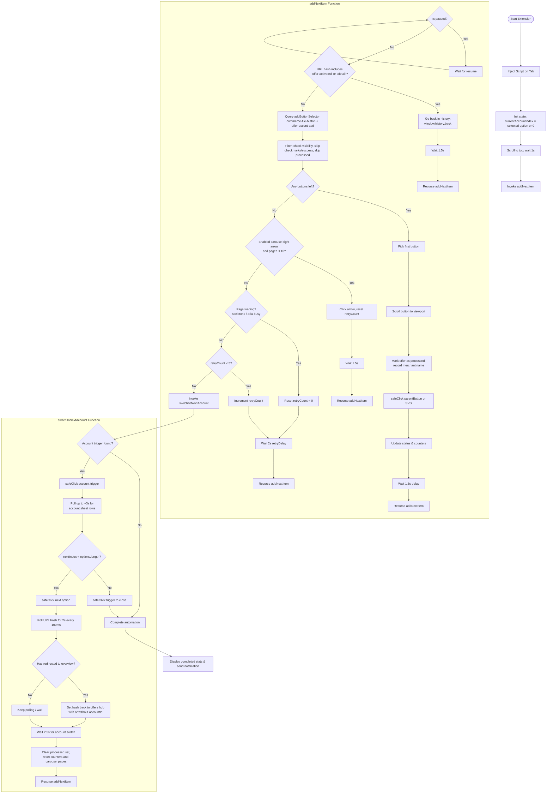

# Technical Documentation

This document provides detailed technical information for developers working with the Chase Offer Adder Chrome extension.

## Architecture Overview

### Core Components

**popup.js** - Main extension logic with two distinct execution contexts:

- **Popup Context**: Handles UI interactions, message passing, and Chrome API calls
- **Injected Script Context**: Content script that runs on Chase pages, containing the automation logic

**Key Architectural Pattern**: The extension uses Chrome's `scripting.executeScript` API to inject a complete automation script into the Chase page. This injected script operates independently and communicates back to the popup via `chrome.runtime.sendMessage`.

### File Structure

```
chase-offer-adder/
├── manifest.json          # Chrome extension manifest (v3)
├── popup.html             # Extension popup UI
├── popup.js               # Main extension logic
├── eslint.config.cjs      # ESLint configuration
├── package.json           # Node.js dependencies and scripts
├── CLAUDE.md              # Project instructions for Claude Code
├── images/                # Extension icons and screenshots
├── tests/                 # Jest test suite
│   ├── setup.js           # Chrome API mocks
│   ├── popup.test.js      # Popup logic tests
│   └── injected-script.test.js  # Automation logic tests
└── node_modules/          # Dependencies
```

## Automation Flow

### Script Injection Process

1. **Script Injection**: Popup injects automation script into active Chase tab using `chrome.scripting.executeScript`
2. **Multi-Section Detection**: Automatically searches for buttons in both carousel (featured offers) and grid (all offers) sections
3. **Tab Discovery**: Automatically detects and cycles through page tabs if present
4. **Button Detection**: Script scans for `[data-cy="commerce-tile-button"]` elements (SVG icons) across all page sections
5. **Already-Added Filter**: Skips offers with checkmark icons (`svg[data-cy="commerce-tile-icon"]`) or success alerts indicating they're already added
6. **Smart Scrolling**: Automatically scrolls buttons into view if they're off-viewport for better reliability
7. **Section Detection**: Identifies whether buttons are in carousel (featured) or grid (all offers) sections
8. **Retry Mechanism**: Implements 5-retry logic with 2-second delays to handle page loading delays (increased from 3 retries/1 second)
9. **Loading Detection**: Detects page loading states (skeleton loaders, aria-busy) and resets retry count accordingly
10. **Tab Switching**: Automatically cycles through all tabs before switching accounts (if tabs are present)
11. **Account Switching**: Automatically cycles through accounts via `[data-testid="account-selector-trigger"]` → `#accountSelectorSheet .accountSelectorListItem`
12. **Navigation**: Uses `window.history.back()` between offers

### Detailed Flow Chart



### State Management

- **Pause/Resume**: Controlled via message passing between popup and injected script
- **Retry Logic**: Prevents premature account switching when pages are still loading
- **Progress Tracking**: Real-time status updates via Chrome runtime messaging

### Message Passing Protocol

The extension uses Chrome runtime messaging for popup ↔ injected script communication:

**From Injected Script to Popup:**

- `script_started` - Automation begins
- `script_paused` - Process paused
- `script_resumed` - Process resumed
- `tab_switched` - Switched to new tab (New, All offers, etc.)
- `account_switched` - Switched to new account
- `no_buttons_found` - No offers available
- `click_error` - Error during button clicking

**From Popup to Injected Script:**

- `pause` - Request to pause automation
- `resume` - Request to resume automation

## Development Setup

### Prerequisites

- Node.js (v16 or higher)
- Chrome browser with Developer Mode enabled

### Installation

```bash
# Clone repository
git clone https://github.com/yourusername/chase-offer-adder.git
cd chase-offer-adder

# Install dependencies
npm install

# Install pre-commit hooks
npm run prepare
```

### Development Commands

```bash
# Testing
npm test                   # Run all tests
npm run test:watch         # Run tests in watch mode
npm run test:coverage      # Run tests with coverage report
jest tests/popup.test.js   # Run specific test file

# Code Quality
npm run lint              # Check linting
npm run lint:fix          # Auto-fix linting issues
npm run format            # Format all files with Prettier
npm run format:check      # Check formatting without changes
npm run validate-manifest # Check manifest.json structure, version format, and version parity with package.json
```

Optional: install [`just`](https://github.com/casey/just) (`brew install just`) to run the same commands via `just check`/`just lint`/etc., and [`gitleaks`](https://github.com/gitleaks/gitleaks) (`brew install gitleaks`) so the pre-commit hook scans staged changes for secrets locally — see [Pre-commit Hooks](#pre-commit-hooks).

### Loading Extension in Chrome

1. Open Chrome and navigate to `chrome://extensions/`
2. Enable "Developer mode" (top-right toggle)
3. Click "Load unpacked"
4. Select the `chase-offer-adder` directory
5. The extension icon will appear in your toolbar

## Testing Architecture

### Test Environment

- **Jest + JSDOM**: Tests run in simulated browser environment
- **Chrome API Mocking**: All Chrome extension APIs mocked in `tests/setup.js`
- **Isolated Testing**: Each test runs independently without browser dependencies

### Test Files

**tests/setup.js** - Global test configuration and Chrome API mocks:

```javascript
// Mocks chrome.runtime, chrome.scripting, chrome.tabs APIs
global.chrome = {
    runtime: { ... },
    scripting: { ... },
    tabs: { ... }
};
```

**tests/popup.test.js** - Tests popup UI logic and Chrome API interactions:

- Button click handlers
- Message passing
- UI state management
- Chrome API calls

**tests/injected-script.test.js** - Tests core automation logic:

- Button detection algorithms
- Retry mechanism
- Account switching logic
- Error handling

## Critical Implementation Details

### Retry Mechanism (Enhanced)

The retry mechanism prevents premature tab/account switching when pages are still loading. The script now implements **5 retries with 2-second delays** (increased from 3 retries with 1-second delays) for better reliability with Chase's dynamic page loading.

**Key Features:**

- **Smart Loading Detection**: Detects skeleton loaders and `aria-busy` states, resetting retry count when page is actively loading
- **Automatic Scrolling**: Scrolls buttons into view before clicking if they're off-viewport
- **Section Awareness**: Identifies whether buttons are in carousel (featured offers) or grid (all offers) sections
- **Progress Preservation**: Only switches tabs/accounts after exhausting all retry attempts

**Implementation (popup.js:282-357):**

```javascript
// Enhanced retry logic with loading detection
let retryCount = 0;
const maxRetries = 5; // Increased from 3
const retryDelay = 2000; // Increased from 1000ms

if (!buttonToClick) {
    // Detect if page is still loading content
    const isLoading =
        document.querySelector('[data-testid*="skeleton"], [class*="loading"]') ||
        document.querySelector('[aria-busy="true"]');

    if (isLoading) {
        retryCount = 0; // Reset retry count if page is actively loading
    }

    if (retryCount < maxRetries) {
        retryCount++;
        setTimeout(() => addNextItem(), retryDelay);
        return;
    }
    // After max retries, try switching tabs then accounts
}
```

### Chrome Extension Permissions

Required permissions in `manifest.json`:

- `activeTab`: Required for content script injection
- `scripting`: Required for `executeScript` API

### Selector Dependencies

Extension relies on specific Chase selectors that may break with website updates:

- **Add buttons**: `[data-cy="commerce-tile-button"]` (SVG elements, changed from mds-icon in Nov 2025), plus `[data-testid="offer-accent-add"]` for "Recommended offers" tiles (Oct 2026). The latter only renders on not-yet-added offers, so it doubles as the "needs adding" check
- **Recommended offer tiles**: `a[data-cy="offer"]` (id `offer-FIGG:<n>`, merchant name in `.offerMerchantName`); the row pages via `[data-testid="carouselRightChevron"]`, which is `disabled` on the last page
- **Already-added indicators**: `svg[data-cy="commerce-tile-icon"]` (checkmark icon) and `[data-cy="offer-tile-alert-container-success"]` (success alert)
- **Offer tile containers**: `[data-cy="commerce-tile"]`, `[data-testid="commerce-tile"]`
- **Carousel section**: `[data-testid*="carousel"]` (featured/highlighted offers)
- **Grid section**: `[data-testid="grid-items-container"]` (all offers)
- **Tab navigation** (optional): Multiple selectors including `button[data-cy*="new"]`, `[role="tab"][aria-label*="New"]`, etc.
- **Account selector trigger**: `[data-testid="account-selector-trigger"]` (a `<button aria-haspopup="dialog">`; fallback `[data-testid="select-credit-card-account"]` for the pre-Oct-2026 combobox)
- **Account display text** (current account name): the trigger button's `textContent` (fallback: `[data-mds-select-value-text="true"]` inside the old combobox)
- **Account sheet options**: `#accountSelectorSheet .accountSelectorListItem` (fallback: `ul[role="listbox"]#menu li[role="option"]`); label text in `.accountSelectorListLabel`

**Notes**:

- **November 2025 Update**: Chase changed from `<mds-icon>` elements to direct `<svg>` elements for add buttons and checkmarks
- **August 2026 Update**: The account selector's `id` attribute is now an auto-generated React id (e.g. `:r1u6:`) that changes per render/session — it is no longer a stable selector. Use `data-testid="select-credit-card-account"` instead. Likewise, the account display text moved from a hashed CSS module class to the stable `data-mds-select-value-text="true"` attribute. Prefer `data-*`/`aria-*` attributes over hashed class names (e.g. `xko37o4`, `iappo6m`) wherever possible, since those hashes churn with every Chase build.
- **October 2026 Update**: Chase replaced the account combobox/listbox with a trigger button that opens a bottom sheet (`#accountSelectorSheet`, rows `.accountSelectorListItem`, label `.accountSelectorListLabel`). The sheet is only in the DOM while open, so the switcher polls for its rows (up to ~3s) after clicking the trigger. These are semantic (non-hashed) class names, so they're reasonably stable; the old combobox selectors are kept as fallbacks. The sheet's "selected" marker is unknown (snapshot was taken with it closed) — the switcher iterates by index, so it doesn't need one.
- The extension automatically searches for buttons in both carousel (featured offers) and grid (all offers) sections on the same page
- Skips offers that already have checkmark icons or success alerts, focusing only on offers with add buttons (plus icons)
- Tab discovery uses multiple selector patterns to find page tabs if they exist
- The automation cycles through all tabs (if present) before switching to the next account

## Code Style & Quality

### ESLint Configuration

```javascript
// eslint.config.cjs
module.exports = [
    js.configs.recommended,
    {
        languageOptions: {
            globals: {
                ...globals.browser,
                ...globals.webextensions,
                chrome: 'readonly'
            }
        }
    }
];
```

### Prettier Configuration

- 4-space indentation
- Single quotes
- No trailing commas
- Line width: 80 characters

### Pre-commit Hooks

Configured via Husky (`.husky/pre-commit`) and lint-staged:

```json
{
    "lint-staged": {
        "**/*.js": [
            "prettier --write",
            "eslint --fix",
            "jest --bail --findRelatedTests --passWithNoTests"
        ],
        "*.{json,html}": ["prettier --write"]
    }
}
```

Before lint-staged runs, the hook also scans staged changes for secrets with [gitleaks](https://github.com/gitleaks/gitleaks) (`gitleaks git --staged`) if it's installed locally (`brew install gitleaks`). If it isn't installed, the hook prints a warning and continues — CI runs gitleaks unconditionally, so this is a fast local heads-up rather than the only gate. If `just` is installed, the hook delegates to `just pre-commit` (see the `justfile`); otherwise it falls back to `npx lint-staged` directly.

## Chrome Extension Manifest (v3)

```json
{
    "manifest_version": 3,
    "name": "Chase Offer Adder",
    "version": "1.0.0",
    "permissions": ["activeTab", "scripting"],
    "action": {
        "default_popup": "popup.html",
        "default_icon": "images/icon128.png"
    },
    "icons": {
        "128": "images/icon128.png"
    }
}
```

## Error Handling

### Common Error Scenarios

1. **No buttons found**: Extension detects no available offers
2. **Click errors**: Button clicking fails due to DOM changes
3. **Account switching failures**: Unable to switch between accounts
4. **Network issues**: Chase website unresponsive

### Error Recovery

- Graceful degradation with clear error messages
- Automatic retry mechanisms for transient failures
- User-controlled pause/resume for manual intervention
- Status updates for transparency

## Performance Considerations

### Memory Management

- Injected script cleans up event listeners
- Limited DOM queries to essential elements
- Efficient message passing between contexts

### Network Efficiency

- Minimal HTTP requests (relies on existing page state)
- Respects Chase's rate limiting through delays
- Graceful handling of slow page loads

## Security Considerations

### Data Privacy

- No personal data collection or storage
- No external network requests
- Only interacts with Chase's legitimate DOM elements

### Content Security Policy

- Follows Chrome extension security best practices
- Uses content script injection instead of inline scripts
- Validates all DOM interactions

## Debugging

### Console Logging

Enable detailed logging by adding to injected script:

```javascript
console.log('Popup received message:', request);
```

### Chrome DevTools

- Use `chrome://extensions/` to reload extension
- Check Console tab for error messages
- Inspect popup.html for UI debugging

### Common Issues

1. **Extension not loading**: Check Developer Mode is enabled
2. **Script not injecting**: Verify activeTab permission
3. **Buttons not found**: Inspect Chase page DOM changes
4. **Message passing fails**: Check Chrome runtime availability

## Continuous Integration

Defined in `.github/workflows/ci.yml`, runs on every push/PR to `main`/`master` and can also be triggered manually (`workflow_dispatch`):

- **`check`** (matrix: Node 18 and 20): install deps, `prettier --check`, `eslint`, `jest --ci --coverage`, and `node scripts/validate-manifest.js`
- **`secrets`**: full git-history secret scan via [`gitleaks/gitleaks-action`](https://github.com/gitleaks/gitleaks-action) (checks out with `fetch-depth: 0` so it sees the whole history, not just the latest commit)
- **`package`** (only on `main`/`master`, requires `check` and `secrets` to pass): zips `manifest.json`, `popup.html`, `popup.js`, `popup.css`, and `images/` into `chase-offer-adder-v<version>.zip` and uploads it as a workflow artifact (30-day retention)

Run the same checks locally with `just ci` (requires `gitleaks`; see [Pre-commit Hooks](#pre-commit-hooks)), or the lighter `just check` for just format/lint/test without the manifest/secrets checks.

## Contributing

### Pull Request Process

1. Fork the repository
2. Create feature branch: `git checkout -b feature-name`
3. Make changes and add tests
4. Run test suite: `npm test`
5. Run linting: `npm run lint`
6. Commit with descriptive message
7. Submit pull request

### Code Review Checklist

- [ ] Tests pass (`npm test`)
- [ ] Linting passes (`npm run lint`)
- [ ] Code follows existing patterns
- [ ] Chrome extension permissions not expanded unnecessarily
- [ ] No security vulnerabilities introduced
- [ ] Documentation updated if needed

### Release Process

1. Update the version in both `package.json` and `manifest.json` to today's date in [CalVer](https://calver.org) format (`YYYY.M.D`, e.g. `2026.8.16`; add a trailing `.N` for a same-day re-release) — `just bump-version <version>` updates both files at once
2. Run `npm run validate-manifest` (or `just validate-manifest`) to confirm the version is Chrome-Web-Store-valid and the two files match
3. Add an entry to `CHANGELOG.md` with the functional changes
4. Push to `main`/`master` — CI packages the zip automatically (`package` job); download it from the workflow run's artifacts, or run `just package` locally
5. Create a GitHub release with the zip file, and test the installation process

## Recent Updates

### Version 1.1 (Current)

**Enhanced Retry Mechanism:**

- Increased retry attempts from 3 to 5 for better reliability
- Increased retry delay from 1 second to 2 seconds
- Added smart loading detection (skeleton loaders, aria-busy states)
- Automatically resets retry count when page is actively loading

**Smart Button Detection:**

- Automatic scrolling for off-viewport buttons
- Section detection (carousel vs grid)
- Better visibility checking

**Improved Timing:**

- Tab switch delay: 1.5 seconds (optimized for content loading)
- Account switch delay: 2.5 seconds (increased for account transitions)
- Random action delays: 300-1300ms (natural behavior simulation)

## Future Improvements

### Potential Enhancements

- **Account filtering**: Allow users to select specific accounts
- **Scheduling**: Run automation at specified times
- **Offer filtering**: Skip certain offer categories
- **Enhanced logging**: Detailed activity logs
- **Success metrics**: Track offers added per session

### Technical Debt

- Consolidate selector configuration
- Improve error message specificity
- Add integration tests with real Chase pages
- Implement proper TypeScript support

---

**Note**: This documentation is maintained alongside code changes. When modifying functionality, please update relevant sections.
